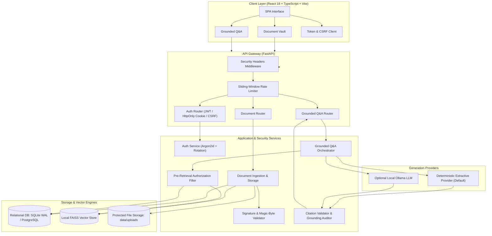

# SecureDocs AI — AI-Powered Secure Document Management System

[](https://www.python.org/)
[](https://fastapi.tiangolo.com/)
[](https://react.dev/)
[](https://www.typescriptlang.org/)
[](https://vite.dev/)
[](#test-suite--quality-metrics)
[](LICENSE)

SecureDocs AI is an enterprise-grade document management and Retrieval-Augmented Generation (RAG) platform. It provides private, local semantic search and grounded Question-Answering over authorized documents with zero external cloud dependencies.

Built with security as a first principle, SecureDocs AI enforces document-level authorization across file storage, vector indexing, semantic search, and generative Q&A, preventing cross-user data leakage and hallucinated citations.

---

## Key Features

- **Document-Level Authorization (ABAC/RBAC):** Strict pre-retrieval access controls guarantee users can only query, search, view, or download documents they are explicitly authorized to access.
- **Local Embedding & Vector Search:** Uses `sentence-transformers/all-MiniLM-L6-v2` and `FAISS` running completely in-process on CPU, requiring no third-party API keys or external SaaS telemetry.
- **Grounded Generative Q&A:** Synthesizes factual answers strictly bounded by authorized source documents, providing verified citation cards with original filenames and verbatim source snippets.
- **Cryptographic Anti-CSRF & HttpOnly Cookies:** Implements HMAC-SHA256 signed double-submit anti-CSRF protection, HttpOnly refresh token cookies, automatic token rotation, and replay detection with family revocation.
- **Robust Ingestion Pipeline:** Supports PDF, DOCX, TXT, and Markdown files up to 25 MB with magic-byte signature inspection, path-traversal prevention, recursive chunking, and SHA-256 integrity verification.
- **Full Automated Test Coverage:** Thoroughly verified with 172 backend regression tests, 43 frontend unit/component tests, static type checking, and linter validation.

---

## System Architecture



---

## Representative RAG & Security Workflow

### 1. Document Ingestion Pipeline
1. **Validation:** Uploaded binary streams are inspected for file size (<= 25 MB), filename path traversal (`..` and control characters stripped), and magic-byte signatures (`%PDF-`, OpenXML ZIP headers for DOCX, null-byte checks for TXT/MD).
2. **Storage:** Saved to `data/uploads/` using a server-generated UUID filename outside the public web root.
3. **Parsing & Chunking:** Extracted into text segments using format-specific parsers (`pypdf`, `python-docx`, standard plaintext), then recursively chunked with 512-character windows and 50-character overlaps.
4. **Vector Embedding:** Chunk embeddings are generated via `sentence-transformers/all-MiniLM-L6-v2` and added to the local FAISS index alongside database chunk records.

### 2. Grounded Q&A Retrieval Pipeline
1. **Pre-Retrieval Authorization:** When a user asks a question, the backend queries the database for all document IDs owned by or explicitly shared with that user.
2. **Authorized Vector Search:** FAISS searches for nearest neighbors; any chunk whose parent document is not in the user's authorized set is strictly dropped.
3. **Prompt Injection Containment:** Retrieved chunks are wrapped inside isolated XML tags (`<source_documents><source>...`) with closing tags escaped, instruct-prompted to prevent prompt overrides.
4. **Citation Validation:** Proposed citations must point to chunks actually retrieved and verified. The `CitationValidator` confirms verbatim snippet containment and hydrates metadata strictly from database ground truth.
5. **Insufficient Evidence Safeguard:** If no authorized chunks exceed the semantic similarity threshold, the system immediately returns an explicit `insufficient_evidence: true` response rather than hallucinating.

---

## Technology Stack

| Component | Technology | Description |
| :--- | :--- | :--- |
| **Backend Framework** | **FastAPI 0.115+** | High-performance async Python web framework with Pydantic v2 schemas. |
| **Relational Database** | **SQLite (WAL mode) / PostgreSQL** | Database persistence with SQLAlchemy 2.0 ORM and Alembic migrations. |
| **Vector Engine** | **FAISS (CPU)** | Local dense vector similarity search with in-memory indexes and disk persistence. |
| **Embedding Model** | **SentenceTransformers** | Local `all-MiniLM-L6-v2` (384 dimensions) running on CPU. |
| **Frontend Framework** | **React 18 + TypeScript** | Single-page application built with Vite, strict TypeScript, and accessible components. |
| **Authentication** | **JWT + HttpOnly Cookies** | Short-lived access tokens, secure HttpOnly refresh cookies, and HMAC-SHA256 CSRF protection. |
| **Testing** | **pytest + vitest + oxlint** | 172 backend regression tests, 43 frontend unit tests, and Oxlint static analysis. |

---

## Test Suite & Quality Metrics

All test suites pass cleanly with 100% pass rates:

```powershell
# Backend Regression Suite (172 tests)
cd backend
.\.venv\Scripts\pytest.exe -v
# Output: 172 passed in 63.33s

# Frontend Test Suite (43 tests across 8 suites)
cd frontend
npm test
# Output: 43 passed in 31.83s

# Frontend Linter
cd frontend
npm run lint
# Output: Found 0 warnings and 0 errors in 48ms

# Frontend Production Build
cd frontend
npm run build
# Output: dist/index.html, dist/assets/index.js (built in 271ms)
```

---

## Prerequisites & Installation

### System Requirements
- **Python:** 3.11 or 3.12 (64-bit)
- **Node.js:** v18+ and npm
- **Git:** 2.40+

### 1. Clone & Configure Workspace
```bash
cd securedocs-ai

# Copy environment template
cp .env.example .env
```

### 2. Backend Setup
```powershell
cd backend

# Create virtual environment
python -m venv .venv

# Activate virtual environment (Windows PowerShell)
.\.venv\Scripts\Activate.ps1

# Upgrade pip and install dependencies
pip install --upgrade pip
pip install -r requirements.txt

# Run database migrations
alembic upgrade head
```

### 3. Frontend Setup
```powershell
cd ../frontend

# Install dependencies
npm install
```

---

## Running the Application Locally

### Terminal 1: Start the Backend Server
```powershell
cd backend
.\.venv\Scripts\Activate.ps1
uvicorn app.main:app --host 127.0.0.1 --port 8000 --reload
```
- **Backend API:** `http://127.0.0.1:8000`
- **Swagger Documentation:** `http://127.0.0.1:8000/api/v1/docs`
- **Health Check:** `http://127.0.0.1:8000/health`
- **Readiness Probe:** `http://127.0.0.1:8000/health/ready`

### Terminal 2: Start the Frontend Client
```powershell
cd frontend
npm run dev
```
- **Web Interface:** `http://127.0.0.1:5173`

---

## Q&A Generation Providers

SecureDocs AI supports modular generation providers via `backend/app/rag/generation/`:

### 1. `deterministic_extractive` (Default)
- **Status:** **Active & Verified**
- Fully deterministic, local, and requires zero external services or GPU acceleration.
- Extracts grounded factual sentences directly from verified retrieved evidence chunks.
- Ideal for offline environments, automated CI/CD pipelines, and high-security air-gapped systems.

### 2. `ollama` (Optional Local LLM)
- **Status:** **Optional Integration**
- Interfaces with a local Ollama daemon at `http://localhost:11434` (model: `llama3.2`).
- To use Ollama:
  1. Install Ollama from [ollama.com](https://ollama.com).
  2. Pull the model: `ollama pull llama3.2`.
  3. Start the daemon: `ollama serve`.
  4. Select **Ollama (Local LLM)** in the Q&A interface dropdown.
- *Note:* If Ollama is offline or times out, the backend gracefully flags the service unavailability or falls back based on `OLLAMA_FALLBACK_TO_EXTRACTIVE` settings.

---

## Security Architecture & Defenses

- **Anti-IDOR (Insecure Direct Object References):** Document lookup by ID strictly verifies ownership (`owner_id == current_user.id`). Unauthorized requests return `404 Not Found` without disclosing document existence.
- **Signed Double-Submit CSRF Protection:** Anti-CSRF tokens are cryptographically signed with HMAC-SHA256 using the server's `SECRET_KEY`. Cookie tossing or subdomain injection attacks are rejected with HTTP 403.
- **Refresh Token Rotation & Replay Alarms:** Refresh tokens rotate on every use. Replaying an old refresh token invalidates the entire token family, requiring re-authentication.
- **Unbounded Memory Protection:** File uploads are streamed in 64 KiB bounded chunks; uploads exceeding 25 MB are aborted immediately, preventing memory exhaustion.
- **Fail-Closed Security Headers:** Enforces `nosniff`, `DENY` framing, strict referrer policies, and Content Security Policy (`CSP`) headers on every response.

---

## Current Limitations & Production Blockers

Prior to production deployment with real confidential organizational documents:
1. **HTTPS Termination:** Production requires active TLS termination with `ENABLE_HSTS=True` and setting `ENVIRONMENT=production` with a cryptographically generated 32+ character `SECRET_KEY`.
2. **Database Engine:** SQLite WAL mode is ideal for single-node development; production requires PostgreSQL to handle concurrent multi-user write transactions and audit logging.
3. **Application Encryption-at-Rest:** Implement envelope encryption (e.g. AES-256-GCM) for uploaded document files stored in `data/uploads/`.
4. **Vector Store Scaling:** For horizontal multi-container deployments, transition from in-memory FAISS to a distributed vector database (e.g. `pgvector` or Qdrant).

---

## Future Roadmap

- [ ] **Multi-Tenant Organization Hierarchies:** Departmental and organizational role hierarchies with granular group sharing.
- [ ] **Scanned Document OCR:** Integration of Tesseract / EasyOCR for image-based PDFs and scans.
- [ ] **Semantic Vector Caching:** Caching frequent semantic search results to reduce embedding latency.
- [ ] **S3 / Blob Storage Connector:** Optional cloud storage backend for document binaries.
- [ ] 
